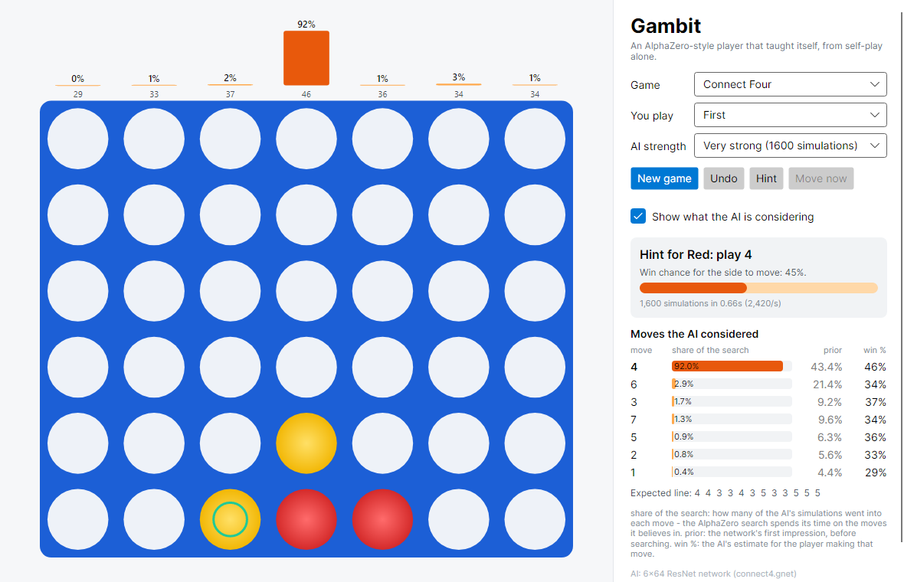
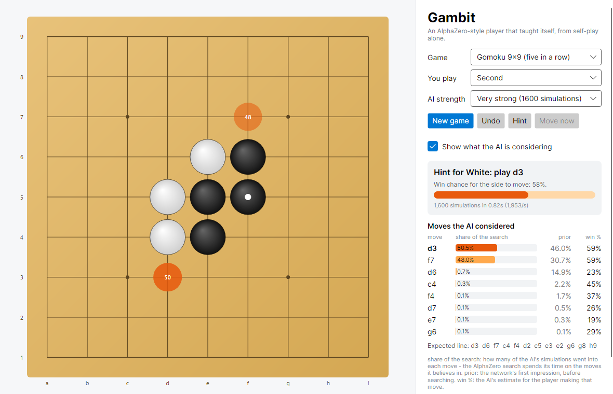

# Gambit

**An AlphaZero-style game AI in C#.** It starts with no human games, no opening book and no hand-written evaluation. It learns Connect Four (and 9×9 Gomoku) by playing hundreds of thousands of games against itself, and its strength is measured as it grows, against fixed opponents and against a perfect solver.



How it is built:
- **Search:** Monte Carlo Tree Search guided by a two-headed residual network, which proposes moves and judges positions. Hundreds of games run in parallel, and their leaf evaluations go to the GPU in large batches.
- **Training:** in C# with [TorchSharp](https://github.com/dotnet/TorchSharp) (PyTorch's engine from .NET).
- **Desktop app:** written with Avalonia, it runs the trained network in plain C# with SIMD and no libtorch. While you play, it shows which moves the AI is considering and how sure it is of each.

⟨RESULTS⟩

## How it learns

```
           ┌────────────────────────── generation g ───────────────────────────┐
 best net ─┤ 1. self-play   4096 games, MCTS with 200 simulations per move     │
           │ 2. training    the trained net learns from the recent positions   │
           │ 3. gating      candidate vs best, 200 games: it replaces the best │──> best net
           │                only if it scores >= 55%                           │
           │ 4. rating      Elo update; every 5 generations: matches against   │
           │                fixed opponents and grading by the perfect solver  │
           └───────────────────────────────────────────────────────────────────┘
```

**The network** has an input, a tower and two heads:
- **Input:** 3 planes (own stones, opponent stones, side to move).
- **Tower:** a 3×3 convolution, then 6 residual blocks of 64 channels.
- **Policy head:** a probability for every move.
- **Value head:** the expected result in [−1, 1].

**The search.** MCTS with PUCT selection, as in AlphaZero, plus a few refinements:
- **First-play urgency:** an unvisited move starts at the parent's value minus a small reduction, so the search widens only when it has a reason to.
- **Dirichlet noise** at the root during self-play.
- **Tree reuse:** the subtree of the move played is kept between moves and compacted.
- **Virtual loss:** several leaves of one tree can be evaluated in one batch.

**Self-play throughput.** This is what limits AlphaZero, so most of the engineering went here:
- **Bitboards.** Connect Four uses two 64-bit integers and finds a win with four shift-and-AND pairs. Gomoku uses `UInt128` bitboards with a sentinel column. The move generator runs at 40M moves/s on one thread.
- **Game-level batching.** 2048 games advance in lock-step. Each step:
  1. all trees select a leaf, in parallel on the CPU;
  2. one GPU call evaluates them all, in fp16, with the batch padded to a fixed size so cuDNN doesn't plan a new shape at every call;
  3. all trees expand and back up, in parallel.

  A lock-free cache of evaluations skips about a third of the network calls, because every game starts from the same position and openings repeat.
- **Playout cap randomisation** ([KataGo](https://arxiv.org/abs/1902.10565)). 25% of moves get a full 200-simulation search and become training examples. The rest are played with 40 simulations and recorded nowhere, so games finish ~3× faster without weakening the targets.
- **Symmetry augmentation.** Every training position is used in a random mirror image (and in Gomoku, any of the 8 symmetries of the square).

With all this, an RTX 2060 plays about **110 games/s ≈ 190,000 simulations/s** of Connect Four self-play.

**Gating and Elo.** After training, a candidate network plays the current best in a 200-game match, with colours alternating and the first moves sampled. It replaces the best only if it scores at least 55%. Elo comes from maximum likelihood (the Bradley–Terry model, by Hunter's MM algorithm) over all the games played. The scale is anchored at a fixed opponent: classic MCTS with random rollouts and 200 simulations, rated 0.

Gating matches are a chain in which each network meets only its predecessor, which tends to inflate the ratings. So the final curve also comes from a **round-robin tournament** between saved generations, where every network meets every other.

**Measured against perfect play.** Connect Four is a solved game, so Gambit includes a perfect solver to grade the AI exactly. It is a negamax search on bitboards, after Pascal Pons:
- alpha-beta pruning;
- a transposition table;
- ordering moves by the threats they create;
- discarding moves that hand the opponent a win;
- a null-window search that narrows the score by bisection.

The test set holds 1000 positions, 10–30 moves deep, every move scored exactly (`data/connect4-solved.txt`). Trivial positions are excluded: one-move wins, forced blocks, and positions where every move is equally good. On them Gambit reports two numbers:
- **Blunder rate:** among positions that are not already lost, how often the AI's move throws away the win or the draw.
- **Score against the perfect player:** after 10 random opening moves, each opening is played twice with colours swapped, so a perfect player would score exactly 50%.

## The desktop app

`src/Gambit.App` (Avalonia, Windows / Linux / macOS):

- **What you can choose:**
  - the game (Connect Four or 9×9 Gomoku);
  - your colour, or both sides for analysis;
  - the AI's strength, from the raw network (1 simulation) to 6400 simulations.
- **Live view of the search:**
  - **Above each column (or on each cell):** the share of the simulations spent on that move, updated as the AI thinks. AlphaZero's search spends its time on the moves it believes in.
  - **Win-chance bar:** the AI's estimate of its own winning chances.
  - **Move table:** the moves considered, each with its search share, its *prior* (the network's first impression before searching) and its win estimate.
  - **Expected line:** the sequence of moves the AI expects.
- **Buttons:** *Hint* analyses the position for you, *Undo* takes back a move, and *Move now* stops the search.

The networks ship in `models/` as `.gnet` files of about 2 MB. They run in plain C#: the batch norms are folded into the convolutions at export time, and an AVX2/FMA kernel computes 64 output channels per pass. A test checks this engine against a direct implementation, and the benchmark checks it against TorchSharp; they agree to 2·10⁻⁶. So the app needs neither libtorch nor a GPU.



## Running it

Requirements:
- the .NET 9 SDK;
- for training, an NVIDIA GPU (TorchSharp downloads libtorch with CUDA, about 2.5 GB, on the first build).

The app and the tests need no GPU.

```bash
# the desktop app (uses models/connect4.gnet and models/gomoku.gnet)
dotnet run --project src/Gambit.App -c Release

# tests (games, search, solver, self-play, arena, Elo, the C# network)
dotnet test tests/Gambit.Tests -c Release

# train from scratch (resumes automatically if interrupted)
dotnet run --project src/Gambit.Cli -c Release -- train --game connect4 --generations 80
dotnet run --project src/Gambit.Cli -c Release -- train --game gomoku --generations 40

# measure a run
gambit eval       --game connect4 --run runs/connect4 --every 5     # blunders, vs perfect play, per generation
gambit tournament --game connect4 --run runs/connect4 --every 10    # round-robin Elo
gambit chart      --game connect4 --run runs/connect4                # runs/connect4/progress.svg

# other tools
gambit bench --game connect4                                         # speed of every component
gambit arena --game connect4 --a models/connect4.gnet --b perfect --games 100
gambit arena --game connect4 --a runs/connect4/models/gen-0040.pt --b rollout:20000
gambit play  --game connect4                                         # console game
gambit export --game connect4 --model runs/connect4/models/best.pt --out models/connect4.gnet
```

(`gambit` is `dotnet run --project src/Gambit.Cli -c Release --`, or the `gambit.exe` built in `src/Gambit.Cli/bin`.)

`train` options, with the Connect Four defaults:

| option | default | meaning |
|---|---|---|
| `--games` | `4096` | self-play games per generation |
| `--parallel` | `2048` | games played at the same time (batch size) |
| `--sims` / `--fast-sims` | `200` / `40` | simulations for full / fast moves |
| `--full-prob` | `0.25` | share of moves that get a full search and become samples |
| `--blocks` / `--channels` | `6` / `64` | network size |
| `--lr` | `0.02` | SGD learning rate (×0.3 after 60% of the run, ×0.1 after 85%) |
| `--window` | `250000` | replay window (positions) |
| `--reuse` | `4` | how many times each new position is used in training |
| `--gate` | `0.55` | score a candidate needs to become the best |
| `--fp32` | off | self-play inference in fp32 instead of fp16 |

## Project layout

```
src/Gambit.Core      no dependencies beyond .NET: everything except training
  Games/             IGame (static abstract interface members), ConnectFour, Gomoku
  Search/            SearchTree (PUCT, virtual loss, tree reuse), evaluators, players, eval cache
  Training/          SelfPlayEngine (batched, playout cap randomisation), ReplayBuffer (+ symmetries)
  Rating/            Elo (Bradley-Terry MLE), Arena (batched matches between two searchers)
  Solver/            ConnectFourSolver (perfect play), the solved test set and its grading
  Neural/            NativeNetwork: the trained network in C# (.gnet format)
  Session/           a game in progress with an AI, for the app
src/Gambit.Neural    TorchSharp: the ResNet, GPU evaluator, trainer, checkpoints and .gnet export
src/Gambit.Cli       train, eval, tournament, arena, bench, chart, play, export
src/Gambit.App       the Avalonia desktop app
tests/Gambit.Tests   xUnit: rules, solver vs brute force, search tactics, self-play targets,
                     replay files, arena, Elo, C# network vs a direct implementation, sessions
data/                the 1000 solved Connect Four test positions
models/              the trained networks used by the app
```

The game is a type parameter everywhere (`SearchTree<TGame>`, `SelfPlayEngine<TGame>`, …), with `TGame` a small struct that implements `IGame<TGame>` through C# 11's static abstract members. The JIT therefore compiles the search separately for each game, with no virtual calls and no allocations per simulation. Adding a game means writing one struct.

## Publishing to GitHub

```bash
cd Gambit
git init                                   # already done if the folder has a .git directory
git add -A
git commit -m "Gambit: AlphaZero-style self-play AI in C#"

# create an empty repository named "Gambit" on github.com (no README, no .gitignore), then:
git remote add origin https://github.com/YUStulinu/Gambit.git
git branch -M main
git push -u origin main
```

After later changes: `git add -A && git commit -m "..." && git push`.

## License

MIT
